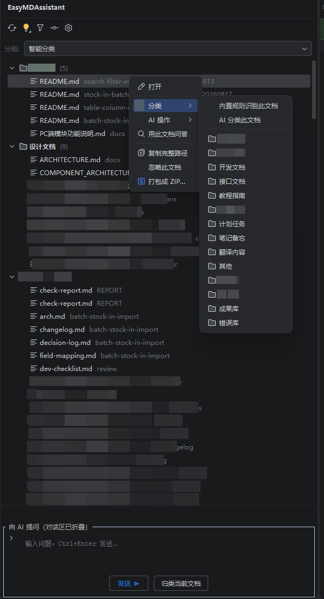
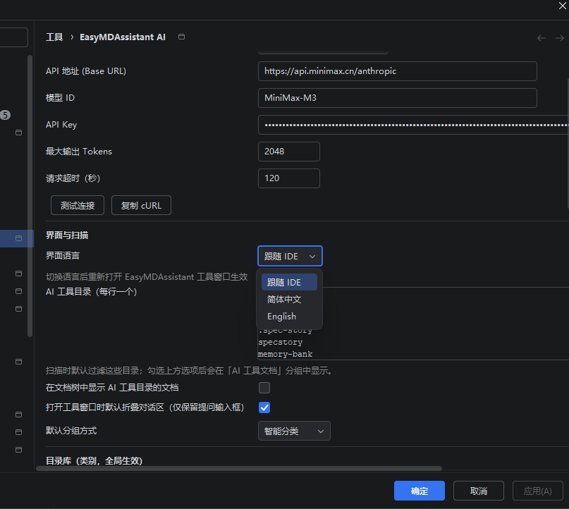

# EasyMDAssistant

简体中文 | **[English](README.md)**

一个功能纯粹的 IntelliJ IDEA 插件：**左侧工具窗口扫描并分类展示项目全部 Markdown 文档 + 接入大模型完成 AI 分类 / AI 问答 / AI 文档操作 + 知识库驱动的项目 AI 规则生成**。

兼容 **IntelliJ IDEA 2021.1 及之后的所有版本**（Community / Ultimate 均可，纯 Java 实现、零第三方运行时依赖）。**界面支持中英双语切换**。



## 功能总览

### 1. 扫描 & 展示
- 工具窗口位于左侧活动栏，打开即自动全项目扫描 `.md` / `.markdown`
- 自动跳过 `node_modules`、`build`、`target`、`.git`、`venv` 等目录
- 五种分组方式可切换：**按目录 / 智能分类 / 按日期 / 保持原层级 / 不分组**（不分组固定在最后），双击打开文档；默认分组方式可在设置中配置
  - **按日期**：按修改日期建组，最新日期组与组内最新文档都排在最上
  - **保持原层级**：按项目原始目录结构原样建树（多级嵌套、全路径保留），不使用任何插件分类 —— 适合自己维护 Markdown 目录结构的项目
- **AI 工具目录一键过滤**：预置 30+ 主流 AI 工具目录名单（.codex、.workbuddy、.claude、.cursor、.aider、.continue、.windsurf、.gemini、.qwen、.kiro、.trae、.cline、.augment、.roo、.goose、memory-bank 等），默认扫描时过滤；工具栏漏斗按钮一键显示/隐藏，显示时归入「AI 工具文档」分组；名单可在设置中增删

### 2. 文档分类（目录库 + 三引擎，按优先级叠加）
**目录库**：内置 10 个类别（项目说明/设计文档/开发文档/接口文档/教程指南/会议记录/计划任务/笔记备忘/翻译内容/其他），设置页可**编辑、新增、删除、恢复默认**；全局生效，是 AI 分类、映射下拉、知识库选择的统一词表。

| 优先级 | 引擎 | 说明 |
|---|---|---|
| 1 | **手动文件夹映射** | 设置页维护「目录前缀 → 类别」表格（类别从目录库选取，也可自定义），最长前缀优先 |
| 2 | **知识库目录** | 文档位于知识库目录下时自动归入对应分组 |
| 3 | **AI 大模型分类** | 批量（工具栏）、单文件（右键）、对话式（「归类当前文档」）；AI 候选类别 = 目录库 + 知识库目录，结果按文件记忆 |
| 4 | **内置规则分类** | 90+ 关键词启发式打分（免联网），实时生效；命中的类别不在目录库时视为未分类 |

**右键「分类」二级菜单直接平铺目录**：菜单下方直接列出目录库全部类别（无需弹窗），点击任一类别即把文档**物理移动**到项目根目录下对应文件夹（自动创建，同名自动加时间戳），移动后自动归类并重新扫描。

**多选打包 ZIP**：Ctrl/Shift 多选文档后右键「打包成 ZIP…」，ZIP 内部结构**跟随当前分组模式**——智能分类按「类别/文件名」两级组织，不分组则平铺，按目录分组保留原路径；同名文件自动加序号，打包完成自动在资源管理器中定位。

**忽略文档**：右键「忽略此文档」后不再出现在扫描结果中；设置页「忽略的文档」栏目列出路径与忽略时间，支持「还原选中 / 全部还原」，还原后点「重新扫描」恢复。

### 3. 知识库 + 项目 AI 规则
四个知识库角色（**目录从目录库中下拉选择**，选「未启用」即停用）：
- **需求库** —— 开发前先读
- **示例库** —— 生成代码优先参考
- **成果库** —— 任务产出归档写入
- **错误库** —— 记录踩坑教训

知识库目录为**项目级配置**（新项目自动沿用全局默认）；设置页提供「**保存为全局默认（所有项目）**」与「恢复全局默认」按钮，一键把当前项目的选择推广到所有项目。

工具栏「**同步 AI 规则**」把以上约定写入项目 AI 规范文件（默认 `AGENTS.md`，可改为 `CLAUDE.md` 等）：自动汇总错误库中每篇教训为「避免」清单，并生成「优先参考示例库」「产出归档成果库」「先读需求库」等规则段落。使用标记块合并，不破坏文件中的手写内容。Codex / Claude Code / Cursor 等工具读取该文件即可遵循这些约定。四个段落均可独立开关，还支持附加自定义规则。

### 4. AI 问答与操作
- **AI 对话**：下半区对话面板，**「上下文」区选择作为参考的文档**（提问时其全文注入对话，最多 15000 字符，悬停有提示），多轮对话 + SSE 流式输出（Ctrl+Enter 发送），可随时停止
- **对话式文档管理**：直接在对话中下达指令，例如「过滤掉所有 SKILL.md 和 docs/tmp 下的文档」「把所有文档分类」「清除过滤规则」，AI 返回结构化结果后自动应用到文档树；过滤规则项目级持久化、支持 `*` 通配符
- **AI 快捷操作**（右键菜单）：总结全文 / 翻译成英文 / 润色优化 / 生成大纲 / 提取待办；结果可复制、追加到原文末尾、或另存为新文档（`*-ai.md`）

### 5. AI 服务商（双协议通用格式）

设置页「**导入 cc-switch 配置**」可自动读取 cc-switch（`~/.cc-switch/config.json`）以及 Claude Code / Codex 当前生效的服务商配置，选择后一键填入。

| 服务商 | 协议 | 地址示例 | 模型示例 |
|---|---|---|---|
| OpenAI 兼容 | `POST {base}/v1/chat/completions` | `https://api.openai.com` | `gpt-4o-mini` |
| DeepSeek | OpenAI 兼容 | `https://api.deepseek.com` | `deepseek-chat` |
| 智谱 GLM | OpenAI 兼容 | `https://open.bigmodel.cn/api/paas/v4` | `glm-4.6` |
| MiniMax | Anthropic | `https://api.minimax.cn/anthropic` | `MiniMax-M3` |
| Anthropic | Anthropic | `https://api.anthropic.com` | `claude-sonnet-4-5` |



### 6. 双语界面
`Settings → Tools → EasyMDAssistant AI → 界面语言`：跟随 IDE / 简体中文 / English。切换后重新打开 EasyMDAssistant 工具窗口生效。

## 安装

兼容 **IntelliJ IDEA 2021.1+**（Community / Ultimate 均可）。

- **JetBrains Marketplace** —— 审核中
- **本地安装**：`File / Settings → Plugins → ⚙ → Install Plugin from Disk…` 选择发布的 zip，重启即可

## 使用

1. 安装后打开任意项目，左侧点开 **EasyMDAssistant** 工具窗口
2. `Settings → Tools → EasyMDAssistant AI` 配置服务商 / API Key / 模型（点「测试连接」验证）
3. （可选）配置知识库目录名、AI 规则文件路径、文件夹映射
4. 工具栏：**重新扫描** · **智能分类**（规则/AI）· **漏斗**（AI 工具文档开关）· **同步 AI 规则** · **设置**
5. 右键文档：打开 / 分类 / AI 操作 / 用此文档问答 / 复制路径

## 从源码构建

要求：JDK 17+（仅用于运行 Gradle，产物字节码为 Java 11）。

```bash
./gradlew buildPlugin        # 产物在 build/distributions/*.zip
./gradlew runIde             # 沙箱 IDEA 中试运行
./gradlew runPluginVerifier  # 兼容性验证（IC-2021.1 / IC-2024.2.1）
```

首次构建会自动下载 IntelliJ 2021.1 SDK（约 700MB）。Gradle 分发包使用腾讯镜像。

## 工程结构

```
src/main/java/com/aitools/mdassistant/
├── MdToolWindowFactory.java        # 工具窗口入口
├── ai/
│   ├── AiClient.java               # OpenAI/Anthropic 双协议 HTTP 客户端（SSE 流式）
│   ├── AiConfig.java / AiSettings.java   # 配置（含 AI 工具目录/知识库/规则/语言）
│   ├── CcSwitchImporter.java       # cc-switch / Claude Code / Codex 服务商配置发现与导入
│   └── Json.java                   # 内置极简 JSON 解析器（零依赖）
├── cat/
│   ├── AiClassifier.java           # 批量 AI 文档分类
│   ├── RuleClassifier.java         # 内置关键词规则分类（免联网）
│   ├── AiRulesGenerator.java       # 项目 AI 规范文件生成（AGENTS.md 等）
│   └── CategoryService.java        # 分类结果 + 文件夹映射持久化（项目级）
├── model/MdFile.java
├── scan/MdScanner.java             # 全项目 MD 扫描（BFS + 目录排除 + AI 目录过滤）
├── ui/
│   ├── MdToolWindowPanel.java      # 文档树 + 工具栏 + 右键菜单 + 规则同步
│   ├── ChatPanel.java              # 流式 AI 对话 + 对话式分类
│   ├── AiResultDialog.java         # AI 操作结果（复制/追加/另存）
│   └── settings/                   # 设置页（五大区块）
└── util/                           # 双语 I18n、通知、文件文本读取
```

## 已知限制

- **网络代理**：优先使用 IDE 的 HTTP Proxy 设置（支持 PAC，解析在后台线程进行且有 5 秒超时兜底），其次识别 `HTTPS_PROXY` / `HTTP_PROXY` / `ALL_PROXY` 环境变量；都不配置则直连。代理需认证（407）时暂不支持自动登录
- 对话上下文文档内容最多截取 15000 字符；AI 操作文档最多 20000 字符
- 文档数量上限 5000 个；错误库汇总到 AI 规则时最多 30 条
- OpenAI 协议下 `o1/o3/gpt-5*` 系列模型自动省略 `max_tokens` 参数
- 双语覆盖界面文案；10 个内置类别名与 AI 提示词保持中文（分类数据一致性）
- 「测试连接」显示实际请求地址与直连/代理状态，并有 40 秒超时兜底

## 许可

[Apache-2.0](LICENSE)
